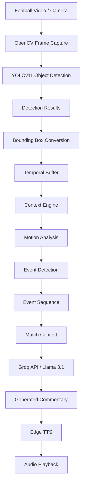
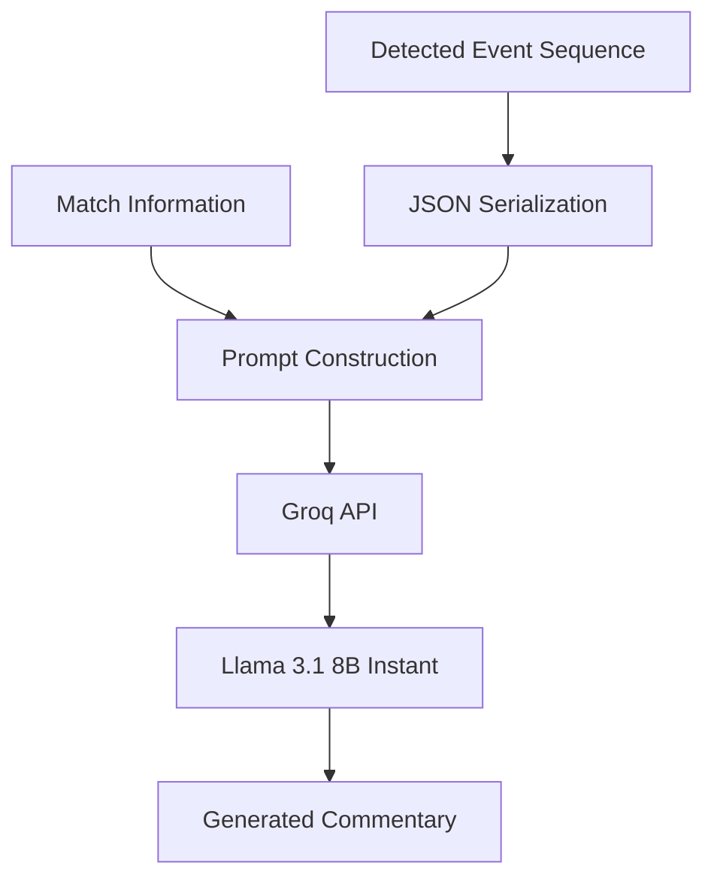
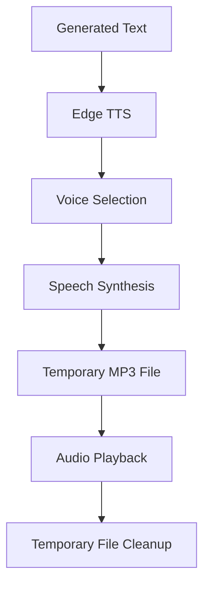
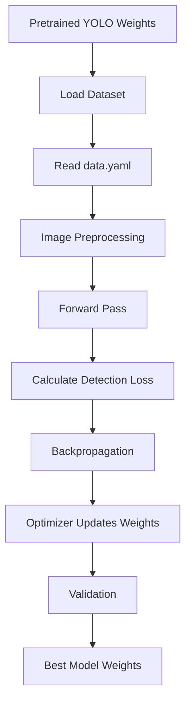

# ⚽ RTVAIN — Real-Time Vision-Based AI Narration

<p align="center">
  
  
  
  
  
</p>

<p align="center">
  <b>From pixels to perception. From perception to understanding. From understanding to live commentary.</b>
</p>

<p align="center">
  An AI-powered football video understanding and narration pipeline that combines object detection, temporal event analysis, large language models, and neural text-to-speech to transform visual football actions into natural spoken commentary.
</p>

---

## 📑 Table of Contents

<details open>
<summary><b>Explore the documentation</b> — Click to expand or collapse</summary>

- [01. Project Overview](#-01-project-overview)
- [02. The Problem We Are Solving](#-02-the-problem-we-are-solving)
- [03. What RTVAIN Actually Does](#-03-what-rtvain-actually-does)
- [04. System Architecture](#-04-system-architecture)
- [05. Understanding the Complete Pipeline](#-05-understanding-the-complete-pipeline)
- [06. Technical Deep Dive](#-06-technical-deep-dive)
  - [Object Detection](#61-object-detection--yolov11)
  - [Bounding Boxes](#62-bounding-box-representation)
  - [Temporal Context Engine](#63-temporal-context-engine)
  - [Motion Estimation](#64-motion-estimation)
  - [Event Detection](#65-football-event-detection)
  - [Sliding Window](#66-sliding-window-processing)
  - [LLM Commentary](#67-intelligent-commentary-generation)
  - [Text-to-Speech](#68-text-to-speech-generation)
- [07. Repository Structure](#-07-repository-structure)
- [08. Technologies and Their Roles](#-08-technologies-and-their-roles)
- [09. Dataset and Data Preparation](#-09-dataset-and-data-preparation)
- [10. Model Training](#-10-model-training)
- [11. Installation and Setup](#-11-installation-and-setup)
- [12. Running the Project](#-12-running-the-project)
- [13. Configuration](#-13-configuration)
- [14. Understanding the Execution Flow](#-14-understanding-the-execution-flow)
- [15. Testing and Evaluation](#-15-testing-and-evaluation)
- [16. Current Implementation and Limitations](#-16-current-implementation-and-limitations)
- [17. Future Development Roadmap](#-17-future-development-roadmap)
- [18. Learning Path](#-18-learning-path)
- [19. Frequently Asked Questions](#-19-frequently-asked-questions)
- [20. Contributing](#-20-contributing)
- [21. Acknowledgements](#-21-acknowledgements)

</details>

---

# 🎯 01. Project Overview

**RTVAIN** is a computer vision and artificial intelligence project designed to understand football penalty sequences from video and generate natural-language audio commentary.

Traditional object detection systems identify objects within images. However, identifying a football, goalkeeper, or goalpost does not explain what is happening in a football match.

For example:

- A football is detected.
- A goalkeeper is detected.
- The football changes position.
- The goalkeeper moves towards the ball.
- The ball enters the goal.

These individual observations need to be interpreted as a meaningful event.

RTVAIN addresses this challenge by connecting multiple AI components into a unified processing pipeline.

### The central idea

```text
VIDEO
  |
  v
OBJECT DETECTION
  |
  v
TEMPORAL UNDERSTANDING
  |
  v
EVENT INTERPRETATION
  |
  v
NATURAL LANGUAGE GENERATION
  |
  v
SPEECH SYNTHESIS
  |
  v
LIVE COMMENTARY
```

### Project objectives

| Objective | Purpose |
|---|---|
| Visual perception | Identify important football entities |
| Motion understanding | Analyze object movement across frames |
| Event recognition | Identify penalty-related outcomes |
| Context generation | Organize detected events into meaningful sequences |
| Language generation | Generate natural football commentary |
| Speech synthesis | Convert generated commentary into audio |
| Real-time processing | Process video and generate commentary during playback |

---

# 🧩 02. The Problem We Are Solving

## Why is object detection alone insufficient?

Imagine a football penalty video.

A conventional object detection model might produce:

```json
{
  "frame": 120,
  "detections": [
    {"class": "ball"},
    {"class": "keeper"},
    {"class": "goal_post"}
  ]
}
```

This tells us which objects are present.

But it does not directly tell us:

- Has the player kicked the ball?
- Is the ball moving towards the goal?
- Is the goalkeeper attempting a save?
- Has the ball entered the goal?
- Was the penalty successful?

The difference is between **visual recognition and temporal understanding**.

### Three levels of understanding

| Level | Question | Example |
|---|---|---|
| Perception | What do we see? | Ball, goalkeeper, goalpost |
| Understanding | What is happening? | Ball is moving towards the goal |
| Interpretation | What does it mean? | A penalty kick results in a goal |

RTVAIN attempts to connect these three levels.

<details>
<summary><b>Why does temporal information matter?</b></summary>

A single image provides spatial information.

A sequence of images provides spatial and temporal information.

For example:

```text
Frame 1: Ball is stationary
Frame 2: Ball is stationary
Frame 3: Ball starts moving
Frame 4: Ball moves rapidly
Frame 5: Ball approaches the goalkeeper
Frame 6: Ball enters the goal
```

The meaning comes from the change between frames, not merely from the objects detected in each frame.

This is why the project maintains a history of detections and positions.

</details>

---

# 🚀 03. What RTVAIN Actually Does

The current implementation focuses on football penalty sequences.

### Input

- Recorded football video.
- Trained YOLO object detection model.
- Match information such as player names and score.

### Processing

1. Read video frames using OpenCV.
2. Detect football-related objects using YOLO.
3. Convert model outputs into bounding-box coordinates.
4. Maintain a temporal history of detections.
5. Estimate ball movement.
6. Apply geometric rules to identify penalty events.
7. Collect events into a sequence.
8. Send the sequence and match context to a language model.
9. Generate a commentary sentence.
10. Convert the sentence into spoken audio.

### Output

- Video playback with detection boxes.
- Console-based event information.
- Generated natural-language commentary.
- Spoken audio commentary.

---

# 🏗️ 04. System Architecture

## 4.1 High-level architecture



## 4.2 Component responsibilities

| Component | Responsibility | Technology |
|---|---|---|
| Video capture | Read frames | OpenCV |
| Object detection | Detect football objects | YOLOv11 |
| Detection processing | Convert coordinates | Python |
| Temporal analysis | Maintain frame history | Deque |
| Event recognition | Interpret movement | Geometric algorithms |
| Commentary generation | Generate natural sentences | Groq / Llama |
| Speech generation | Convert text into speech | Edge TTS |
| Playback | Play generated audio | playsound3 |
| Concurrency | Avoid blocking video processing | Python threading |

## 4.3 Data flow architecture

The most important design principle is that each component passes structured information to the next component.

For example:

**Stage 1 — Raw video frame**

```python
frame = cap.read()
```

**Stage 2 — Object detection**

```python
results = model.predict(frame)
```

**Stage 3 — Structured detections**

```python
detections = [
    {
        "class": "ball",
        "bbox": [420, 300, 25, 25]
    },
    {
        "class": "keeper",
        "bbox": [600, 200, 90, 180]
    }
]
```

**Stage 4 — Temporal analysis**

```python
result = context_engine.update(
    frame_id,
    detections
)
```

**Stage 5 — Event sequence**

```python
sequence_events = [
    {"event": "kick", "frame": 55},
    {"event": "goal", "frame": 60}
]
```

**Stage 6 — Commentary**

```text
A powerful strike finds the back of the net!
```

**Stage 7 — Speech**

The generated sentence is synthesized and played as audio.

---

# 🔬 05. Understanding the Complete Pipeline

## Step 1 — Video acquisition

The system begins by obtaining frames from a video source.

The source can be:

- An MP4 video.
- Another supported video file.
- A camera connected to the computer.

OpenCV is responsible for accessing the video.

```python
cap = cv2.VideoCapture(video_source)

ret, frame = cap.read()
```

**Why do we need frames?**

A video is essentially a sequence of images displayed at a particular frame rate.

For a 30 FPS video:

\[
30\text{ frames} = 1\text{ second}
\]

Processing these frames individually enables the system to observe changes over time.

## Step 2 — Object detection

YOLO identifies the important football entities in each frame.

The current project uses a custom-trained model.

Expected classes include:

- Kicker
- Goalkeeper
- Ball
- Goalpost

## Step 3 — Detection conversion

YOLO provides object locations.

These locations are converted into a common bounding-box representation:

```python
{
    "class": "ball",
    "bbox": [x, y, width, height]
}
```

This representation makes it easier for other modules to process detections without depending on the internal YOLO output structure.

## Step 4 — Temporal processing

The system maintains a sequence of recent detections.

Instead of making decisions from one frame, it considers multiple frames.

This is necessary because movement and events require temporal information.

## Step 5 — Event interpretation

The context engine uses movement and spatial relationships to identify events such as:

- Kick
- Goal
- Save
- Miss

## Step 6 — Commentary generation

Detected events are transformed into structured information.

The structured event information is passed to the LLM with match context.

## Step 7 — Audio generation

The generated sentence is sent to the speech synthesis engine.

The resulting audio is played while the video continues.

---

# 🧠 06. Technical Deep Dive

This section explains not only what each technology does, but also why it exists in the architecture.

## 6.1 Object Detection — YOLOv11

**What is object detection?**

Object detection is a computer vision task that identifies objects and predicts their locations in an image.

It answers two questions:

1. What object is present?
2. Where is the object located?

For RTVAIN, the detector must recognize football-related objects.

### Why YOLO?

YOLO stands for You Only Look Once.

It is a family of object detection models designed to perform object detection efficiently.

The Ultralytics implementation provides a convenient interface for training and inference.

### Detection output

A detection generally contains:

| Field | Meaning |
|---|---|
| Class ID | Numeric class identifier |
| Class name | Predicted object category |
| Confidence | Model confidence score |
| Bounding box | Object location |

Example:

```python
results = model.predict(
    frame,
    conf=0.3,
    verbose=False
)
```

### What is confidence threshold?

A confidence threshold determines which predictions should be retained.

For example:

```python
conf_threshold = 0.30
```

A prediction below the selected threshold is generally excluded.

Increasing the threshold can reduce false detections but may also eliminate genuine objects.

### Why is a custom-trained model necessary?

A general-purpose model may not contain the exact object classes required by the application.

Custom training allows the model to learn the project's target classes from an annotated football dataset.

---

## 6.2 Bounding Box Representation

A bounding box represents the rectangular region containing an object.

RTVAIN uses:

```python
[x, y, width, height]
```

Here:

- `x`: Horizontal coordinate of the top-left corner.
- `y`: Vertical coordinate of the top-left corner.
- `width`: Box width.
- `height`: Box height.

### Coordinate conversion

YOLO commonly provides normalized center-based coordinates:

\[
(x_c,y_c,w,h)
\]

For an image of width \(W\) and height \(H\):

\[
x_1=(x_c-\frac{w}{2})W
\]

\[
y_1=(y_c-\frac{h}{2})H
\]

\[
x_2=(x_c+\frac{w}{2})W
\]

\[
y_2=(y_c+\frac{h}{2})H
\]

The resulting box can be represented using top-left coordinates:

\[
[x_1,y_1,x_2-x_1,y_2-y_1]
\]

**Why convert coordinates?**

Because subsequent geometric operations require consistent coordinates.

For example:

- Calculating object centers.
- Estimating movement.
- Checking intersections.
- Determining whether the ball is inside the goal.

<details>
<summary><b>Understand normalized coordinates with an example</b></summary>

Suppose:

- Image width = 1280 pixels.
- Image height = 720 pixels.
- Normalized center = (0.5, 0.5).
- Normalized width = 0.1.
- Normalized height = 0.1.

The center is:

\[
x_c=0.5\times1280=640
\]

\[
y_c=0.5\times720=360
\]

The bounding box dimensions are:

\[
w=128,\quad h=72
\]

The top-left corner is:

\[
x_1=576,\quad y_1=324
\]

Therefore:

```python
bbox = [576, 324, 128, 72]
```

</details>

---

## 6.3 Temporal Context Engine

File: `context_engine.py`

This is one of the most important components of RTVAIN.

### What is a context engine?

A context engine processes information over time to identify meaningful patterns.

In this project, it maintains recent observations of:

- Ball positions.
- Goalkeeper bounding boxes.
- Goal bounding boxes.

It then uses those observations to determine possible penalty events.

### Why do we need it?

Object detection tells us what is visible.

The context engine attempts to determine what is happening.

For example:

```text
Object detection:
Ball detected in frame 1.
Ball detected in frame 2.
Ball detected in frame 3.

Context analysis:
Ball is initially stationary.
Ball starts moving rapidly.

Possible interpretation:
A kick has occurred.
```

### Internal data structures

The implementation uses Python's `deque`.

```python
self.ball_positions = deque(
    maxlen=frame_window
)

self.keeper_boxes = deque(
    maxlen=frame_window
)

self.goal_boxes = deque(
    maxlen=frame_window
)
```

A deque is a double-ended queue.

It is useful for maintaining a fixed-size history of recent observations.

For example, with a window size of five:

```text
Before new observation:

[Frame 1, Frame 2, Frame 3, Frame 4, Frame 5]

After new observation:

[Frame 2, Frame 3, Frame 4, Frame 5, Frame 6]
```

The oldest observation is automatically removed.

### Why is this useful?

The system does not need to retain every frame's position in memory.

It only needs a recent history for local movement analysis.

---

## 6.4 Motion Estimation

The context engine calculates the distance between two ball positions.

The Euclidean distance formula is:

\[
d=\sqrt{(x_2-x_1)^2+(y_2-y_1)^2}
\]

In Python:

```python
def distance(self, p1, p2):
    return math.sqrt(
        (p2[0] - p1[0]) ** 2 +
        (p2[1] - p1[1]) ** 2
    )
```

### Why calculate distance?

Because a stationary ball and a moving ball have different spatial behavior.

The system can use the distance between consecutive or selected historical positions to estimate movement.

**Important:** The current implementation calculates pixel displacement, not calibrated physical velocity.

Physical velocity would require time information:

\[
v=\frac{\Delta d}{\Delta t}
\]

For accurate physical speed, camera perspective and real-world calibration would also be required.

---

## 6.5 Football Event Detection

The current context engine contains rule-based event detection.

It does not use a separate trained action-recognition model.

### A. Kick detection

The implementation compares early and recent ball displacement.

```python
v_start = self.velocity(
    self.ball_positions[0],
    self.ball_positions[2]
)

v_end = self.velocity(
    self.ball_positions[-2],
    self.ball_positions[-1]
)
```

It uses the following heuristic:

```python
if not self.kick_detected and \
   v_start < 10 and v_end > 40:
```

Interpretation:

- Initially, the ball moves very little.
- Later, the ball moves significantly.
- The system considers this a possible kick.

The thresholds are expressed in pixels, not metres per second.

### B. Save detection

A save is inferred when the ball bounding box intersects the goalkeeper bounding box.

```python
if self.box_intersects(
    current_ball,
    keeper_now
):
    return self.register_event(
        "save",
        frame_id
    )
```

### C. Goal detection

The implementation checks whether the ball center lies within the goal bounding box.

```python
if (
    goal_x1 <= ball_center[0] <= goal_x2
    and
    goal_y1 <= ball_center[1] <= goal_y2
):
    return self.register_event(
        "goal",
        frame_id
    )
```

### D. Miss detection

The current implementation considers a miss when the ball moves beyond the horizontal goal boundaries by a specified margin.

```python
if (
    ball_center[0] > goal_x2 + 30
    or
    ball_center[0] < goal_x1 - 30
):
    return self.register_event(
        "miss",
        frame_id
    )
```

### Event registration

The context engine also maintains an event log and a result flag.

This helps avoid repeatedly registering the same result.

<details>
<summary><b>Important: Current event detection limitations</b></summary>

The existing implementation is a heuristic prototype.

For reliable football event recognition, additional factors should be considered:

- Camera perspective.
- Ball tracking across missed detections.
- Goal-plane crossing.
- Ball trajectory.
- Goalkeeper movement.
- Occlusion.
- Video frame rate.
- False-positive detections.
- Temporal consistency.

Bounding-box intersection alone does not prove that a goalkeeper saved a shot.

Similarly, a ball appearing inside a goal bounding box does not necessarily establish a valid goal.

A more advanced system should combine tracking, trajectory analysis and temporal event validation.

</details>

---

## 6.6 Sliding Window Processing

The main orchestrator uses a fixed-size temporal buffer.

```python
self.buffer = deque(
    maxlen=window_size
)
```

The current default configuration is:

```python
window_size = 8
stride = 3
```

### What is a sliding window?

A sliding window is a technique for processing a limited sequence of consecutive observations.

Instead of processing the entire video as one large sequence, the system examines smaller temporal segments.

Example:

```text
Window 1:
Frames 1–8

Window 2:
Frames 4–11

Window 3:
Frames 7–14
```

The overlap allows the system to preserve recent temporal context.

### What is stride?

Stride determines how frequently a new window is processed.

A smaller stride means more frequent processing.

A larger stride reduces processing frequency.

### Relationship

| Parameter | Effect |
|---|---|
| Window size | How much temporal history is considered |
| Stride | How frequently a window is processed |
| Overlap | Shared observations between consecutive windows |

### Why use sliding windows?

- Maintain temporal context.
- Avoid analyzing only isolated frames.
- Reduce the amount of historical data processed at once.
- Enable repeated event analysis.

---

## 6.7 Intelligent Commentary Generation

File: `narration_generator.py`

The project uses a Groq-hosted Llama 3.1 8B Instant model to generate commentary.

### Why use an LLM?

The context engine produces structured event information.

However, structured information is not natural human language.

For example:

```json
[
  {"event": "kick", "frame": 55},
  {
    "event": "goal",
    "frame": 60,
    "direction": "top-right"
  }
]
```

A language model can transform this into a natural sentence.

Example:

> A powerful strike flies into the top-right corner, and it's a goal!

### Commentary generation process



### Match context

The current implementation accepts information such as:

```python
match_context = {
    "player_kicker": "Messi",
    "goalkeeper": "Neuer",
    "score": "3 - 2"
}
```

### Prompt engineering

The prompt instructs the LLM to:

- Act as a professional football commentator.
- Describe the complete action.
- Mention players' names.
- Include direction when available.
- Generate one short sentence.
- Avoid unnecessary repetition.

### Why JSON?

JSON provides a structured representation of events.

It makes it easier to transfer information between the context engine and commentary generator.

### Why temperature?

The implementation uses:

```python
temperature=0.8
```

Temperature controls the randomness of token generation.

A higher temperature generally allows more variation in generated language.

For consistent sports commentary, the temperature should eventually be evaluated against output quality.

---

## 6.8 Text-to-Speech Generation

File: `tts_engine.py`

After commentary generation, the text needs to be converted into spoken audio.

The current implementation uses:

- `edge-tts`
- `playsound3`
- Asynchronous audio synthesis.

### Processing flow



### Voice configuration

Example:

```python
speaker = TextToSpeech(
    voice="en-GB-RyanNeural",
    rate="+15%"
)
```

The voice determines the speech characteristics.

The rate controls speaking speed.

### Why asynchronous synthesis?

Speech synthesis and playback can take time.

If the main video loop waits for every audio operation, video processing may become delayed.

The main orchestrator therefore starts speech execution in a separate thread.

This allows the video loop to continue while audio is being generated and played.

---

# 📂 07. Repository Structure

The current repository is organized around individual processing modules.

```text
RTVAIN/
│
├── penalties/
│   └── Football penalty video assets
│
├── context_engine.py
│
├── label_visualizer.py
│
├── main_pipelining.py
│
├── narration_generator.py
│
├── test.py
│
├── train.py
│
├── tts_engine.py
│
├── yolo_video_player.py
│
└── README.md
```

Additional assets such as the dataset, model weights, configuration files and environment files may need to be supplied separately.

### File-by-file explanation

<details>
<summary><b>1. main_pipelining.py — Main orchestrator</b></summary>

**Purpose:** Connect all the modules and execute the complete RTVAIN pipeline.

Responsibilities:

- Initialize the YOLO model.
- Initialize the context engine.
- Initialize commentary generation.
- Initialize TTS.
- Capture video frames.
- Maintain a sliding window.
- Process events.
- Generate commentary.
- Execute audio playback in threads.

This is the main entry point for the current integrated implementation.

</details>

<details>
<summary><b>2. context_engine.py — Temporal understanding</b></summary>

**Purpose:** Convert frame-level object detections into penalty-related events.

Responsibilities:

- Maintain ball position history.
- Maintain goalkeeper and goal bounding boxes.
- Calculate displacement.
- Detect possible kicks.
- Determine possible goals, saves and misses.
- Maintain an event log.
- Avoid immediate duplicate event registration.

This module contains the project's rule-based event interpretation logic.

</details>

<details>
<summary><b>3. narration_generator.py — LLM integration</b></summary>

**Purpose:** Generate human-readable football commentary.

Responsibilities:

- Load environment variables.
- Initialize the Groq client.
- Accept structured event information.
- Construct a prompt.
- Call the LLM.
- Return generated commentary.

</details>

<details>
<summary><b>4. tts_engine.py — Speech synthesis</b></summary>

**Purpose:** Convert generated commentary into audio.

Responsibilities:

- Select voice.
- Configure speech rate.
- Synthesize speech.
- Save temporary audio.
- Play the audio.
- Remove temporary files.

</details>

<details>
<summary><b>5. yolo_video_player.py — Standalone detection player</b></summary>

**Purpose:** Provide a separate video detection and visualization implementation.

Responsibilities:

- Load YOLO.
- Capture video.
- Run asynchronous detection.
- Draw bounding boxes.
- Maintain detection records.
- Export detections.

**Note:** The current `main_pipelining.py` directly performs its own detection loop. The standalone player is not the same execution path as the integrated orchestrator.

</details>

<details>
<summary><b>6. label_visualizer.py — Dataset visualization</b></summary>

**Purpose:** Inspect annotated training images.

Responsibilities:

- Read training images.
- Read corresponding YOLO label files.
- Convert normalized coordinates.
- Draw bounding boxes.
- Display and save visualized images.

This helps identify annotation and coordinate-conversion problems before training.

</details>

<details>
<summary><b>7. train.py — Model training</b></summary>

**Purpose:** Fine-tune a pretrained YOLO model using the football dataset.

The script configures:

- Training epochs.
- Image resolution.
- Batch size.
- Optimizer.
- Learning rate.
- Data augmentation.
- Weight decay.
- Training device.

</details>

<details>
<summary><b>8. test.py — Experimental implementation</b></summary>

The currently visible file contains an older commented-out version of the main pipeline.

It should be treated as experimental/reference code rather than a verified automated test suite.

</details>

---

# 🛠️ 08. Technologies and Their Roles

| Technology | Category | Why it is used |
|---|---|---|
| Python | Programming language | Main implementation |
| OpenCV | Computer vision | Video capture and visualization |
| Ultralytics | Deep learning framework | YOLO model training and inference |
| YOLOv11 | Object detection | Football object recognition |
| NumPy | Numerical computing | Useful for image and numerical operations |
| Groq | LLM inference platform | Hosted language model access |
| Llama 3.1 8B Instant | Language model | Commentary generation |
| Edge TTS | Speech synthesis | Text-to-audio conversion |
| playsound3 | Audio playback | Play generated speech |
| python-dotenv | Configuration | Load API credentials |
| threading | Concurrency | Background processing |
| asyncio | Asynchronous execution | TTS synthesis workflow |

### Understanding how the technologies work together

| Requirement | Solution |
|---|---|
| Read a video | OpenCV |
| Recognize objects | YOLO |
| Remember recent detections | Deque |
| Analyze movement | Geometric calculations |
| Recognize penalty events | Rule-based logic |
| Convert events into sentences | LLM |
| Generate voice | Edge TTS |
| Play voice | playsound3 |
| Keep processing responsive | Threading and asyncio |

---

# 📊 09. Dataset and Data Preparation

The model's performance depends heavily on the quality of its training dataset.

The project targets football penalty-related objects.

### Expected object classes

The current visualization script uses:

```python
class_names = [
    'kicker',
    'keeper',
    'ball',
    'goal_post'
]
```

### 9.1 What is an annotated dataset?

An annotated dataset contains images and corresponding labels describing the objects present in each image.

For YOLO detection, every object annotation generally contains:

```text
class_id x_center y_center width height
```

These values are normalized relative to image dimensions.

Example:

```text
0 0.512 0.423 0.120 0.250
2 0.675 0.610 0.025 0.030
```

Each line represents one object.

### 9.2 Expected dataset organization

A conventional YOLO dataset structure is:

```text
dataset/
│
├── images/
│   ├── train/
│   ├── val/
│   └── test/
│
└── labels/
    ├── train/
    ├── val/
    └── test/
```

### 9.3 Dataset configuration

An example `data.yaml`:

```yaml
path: ./dataset

train: images/train
val: images/val
test: images/test

names:
  0: kicker
  1: keeper
  2: ball
  3: goal_post
```

The class IDs must match the actual dataset annotations.

### 9.4 Why visualization is important

Before training, annotations should be inspected visually.

A model cannot learn reliable object locations from incorrect labels.

The `label_visualizer.py` script helps verify:

- Correct class assignment.
- Correct bounding-box coordinates.
- Correct image-label matching.
- Annotation visibility.
- Dataset consistency.

### 9.5 Data quality checklist

- [ ] All images are readable.
- [ ] Every training image has the appropriate label file.
- [ ] Class IDs are consistent.
- [ ] Bounding boxes fit their objects.
- [ ] Important objects are represented.
- [ ] Training and validation sets are separated.
- [ ] Similar video frames are not leaking across splits.

---

# 🧪 10. Model Training

File: `train.py`

The project uses transfer learning with a pretrained YOLO model.

### What is transfer learning?

Transfer learning means using knowledge learned from an existing model and adapting it to a new task.

Instead of training an object detector entirely from scratch, we start with pretrained weights and fine-tune the model on our football dataset.

### Training configuration

The current script contains:

| Parameter | Current value | Purpose |
|---|---:|---|
| Initial model | `yolo11n.pt` | Pretrained starting weights |
| Epochs | 10 | Training iterations |
| Image size | 640 | Input resolution |
| Batch size | 8 | Samples per batch |
| Optimizer | AdamW | Weight optimization |
| Initial LR | 0.001 | Initial learning rate |
| Early stopping patience | 20 | Stop after no improvement |
| Device | CPU | Training hardware |
| Experiment name | `yolov11_T2-n200` | Output run name |

### Training command

```powershell
python train.py
```

### Understanding the training process



### Where are trained weights stored?

Ultralytics generally creates a training directory similar to:

```text
runs/
└── detect/
    └── yolov11_T2-n200/
        └── weights/
            ├── best.pt
            └── last.pt
```

The actual location depends on the training configuration and execution environment.

**Important model-path check:** The current training script names its experiment `yolov11_T2-n200`, whereas the main pipeline references `models/yolov11_T1-n150/weights/best.pt`. Ensure that the model path in the main pipeline points to the model you actually trained.

---

# 💻 11. Installation and Setup

## Prerequisites

- Python 3.10 or later, subject to dependency compatibility.
- Git.
- A working internet connection.
- A Groq API key.
- A compatible video source.
- Sufficient CPU or GPU resources.

A CUDA-compatible GPU is recommended for faster inference, but the current training configuration uses CPU.

## Step 1 — Clone the repository

```bash
git clone https://github.com/Achyut0617/RTVAIN.git
```

```bash
cd RTVAIN
```

## Step 2 — Create a virtual environment

Windows PowerShell:

```powershell
python -m venv .venv
```

Activate:

```powershell
.venv\Scripts\Activate.ps1
```

Linux/macOS:

```bash
python3 -m venv .venv
source .venv/bin/activate
```

## Step 3 — Install dependencies

The repository does not currently provide a verified dependency lockfile. Install the packages used by the visible source code:

```bash
python -m pip install --upgrade pip
```

```bash
pip install ultralytics opencv-python numpy groq python-dotenv edge-tts playsound3
```

Verify the installations:

```bash
python -c "import cv2, ultralytics, groq, edge_tts; print('Dependencies imported successfully')"
```

## Step 4 — Configure the Groq API key

Create a `.env` file in the project root:

```env
GROQ_API_KEY=your_groq_api_key_here
```

Replace the placeholder with your actual API key.

**Security:** Never commit `.env` or expose API credentials in public repositories.

Add the following to `.gitignore`:

```gitignore
.env
.venv/
__pycache__/
*.pyc
runs/
*.mp3
```

## Step 5 — Prepare the model

Place your trained weights at the path configured in `main_pipelining.py`.

For example:

```text
models/
└── best.pt
```

Update the model path accordingly.

## Step 6 — Prepare the video

Place the penalty video in the expected location:

```text
penalties/
└── pen2.mp4
```

Alternatively, change the video source in the main script.

---

# ▶️ 12. Running the Project

## Run the integrated pipeline

```powershell
python main_pipelining.py
```

The current default configuration is:

```python
app = RTVAIN(
    model_path="models/yolov11_T1-n150/weights/best.pt",
    video_source="penalties/pen2.mp4",
    conf_threshold=0.2,
    window_size=8,
    stride=3
)

app.run()
```

Make sure the paths exist before execution.

## Exit the video

Press:

```text
q
```

The system will stop video playback and wait for its tracked speech threads to finish.

## Run standalone detection

The separate detection player can also be integrated into a standalone script:

```python
from yolo_video_player import YOLOVideoPlayer

player = YOLOVideoPlayer(
    model_path="models/best.pt",
    video_source="penalties/pen2.mp4",
    conf_threshold=0.3
)

player.start()
```

This is a separate detection workflow, not the same as running the complete commentary pipeline.

## Run annotation visualization

```powershell
python label_visualizer.py
```

Ensure the configured dataset image and label directories exist.

## Train the model

```powershell
python train.py
```

Ensure `data.yaml` and the dataset are available.

---

# ⚙️ 13. Configuration

The main pipeline exposes several important parameters.

| Parameter | Example | Purpose |
|---|---|---|
| `model_path` | `models/best.pt` | Trained model location |
| `video_source` | `penalties/pen2.mp4` | Video input |
| `conf_threshold` | `0.2` | Detection confidence threshold |
| `window_size` | `8` | Temporal window length |
| `stride` | `3` | Window processing frequency |

### How should these parameters be selected?

**Confidence threshold**

- Lower threshold: More detections, potentially more false positives.
- Higher threshold: Fewer detections, potentially more missed objects.

**Window size**

- Smaller window: Less temporal history.
- Larger window: More temporal history, potentially more processing delay.

**Stride**

- Smaller stride: More frequent window processing.
- Larger stride: Less frequent window processing.

These parameters should be tuned using representative penalty videos and measured performance, rather than selected arbitrarily.

---

# 🔄 14. Understanding the Execution Flow

This section connects the complete implementation to the actual code.

### 14.1 Initialization

The `RTVAIN` class initializes the required modules.

```python
self.model = YOLOVideoPlayer(...)
self.context_engine = ContextEngine(...)
self.commentary_gen = CommentaryGenerator()
self.tts = TextToSpeech(...)
```

Why?

Because the orchestrator needs access to all processing components.

### 14.2 Frame acquisition

```python
ret, frame = cap.read()
```

The system reads the next frame.

If the frame cannot be read, the loop terminates.

### 14.3 Detection

```python
results = self.model.model.predict(
    frame,
    conf=self.model.conf_threshold,
    verbose=False
)
```

The trained YOLO model predicts objects in the current frame.

### 14.4 Buffer update

```python
self.buffer.append({
    "frame": self.frame_counter,
    "detections": detections
})
```

Each frame's structured detections are added to the temporal buffer.

### 14.5 Window processing

```python
if (
    len(self.buffer) == self.window_size
    and
    self.frame_counter % self.stride == 0
):
```

The system starts processing when the buffer is full and the stride condition is satisfied.

### 14.6 Background processing

```python
threading.Thread(
    target=self._process_window,
    args=(list(self.buffer),),
    daemon=True
).start()
```

A separate thread performs context processing.

This helps prevent commentary generation from directly blocking the video loop.

### 14.7 Context analysis

```python
result = self.context_engine.update(
    frame_id,
    frame_data["detections"]
)
```

The context engine analyzes detections and returns an event when its conditions are satisfied.

### 14.8 Commentary generation

```python
commentary = (
    self.commentary_gen.generate_sequence_commentary(
        sequence_events,
        match_context
    )
)
```

The event sequence is passed to the language model.

### 14.9 Speech execution

```python
tts_thread = threading.Thread(
    target=self.tts.speak,
    args=(commentary,),
    daemon=False
)

tts_thread.start()
```

The audio generation and playback are executed in a separate thread.

---

# 📈 15. Testing and Evaluation

A working demonstration is not sufficient to establish the quality of an AI system.

The system should be evaluated at multiple levels.

## 15.1 Object detection evaluation

Useful metrics:

| Metric | What it measures |
|---|---|
| Precision | How many predicted detections are correct |
| Recall | How many actual objects are detected |
| F1-score | Balance between precision and recall |
| mAP@0.5 | Detection accuracy at IoU 0.5 |
| mAP@0.5:0.95 | Detection performance across multiple IoU thresholds |

## 15.2 Event detection evaluation

Create a manually annotated reference dataset of penalty events.

Compare the predicted events against the ground truth.

| Metric | Purpose |
|---|---|
| Event precision | Correctness of predicted events |
| Event recall | Coverage of actual events |
| Event F1 | Overall event detection quality |
| False positive rate | Incorrect event predictions |
| Detection delay | Time between actual and predicted event |

## 15.3 Commentary evaluation

Evaluate generated commentary on:

- Factual correctness.
- Relevance to detected events.
- Player-name correctness.
- Fluency.
- Conciseness.
- Repetition.
- Hallucinated information.

## 15.4 Real-time performance evaluation

Measure:

| Metric | Purpose |
|---|---|
| FPS | Video processing speed |
| Inference latency | Time spent on object detection |
| Event processing latency | Time spent on context analysis |
| LLM response time | Commentary generation delay |
| TTS latency | Time needed for audio synthesis |
| End-to-end latency | Time from event occurrence to spoken commentary |

### Suggested evaluation scenarios

- [ ] Successful penalty resulting in a goal.
- [ ] Penalty saved by goalkeeper.
- [ ] Penalty missed outside the goal.
- [ ] Ball temporarily occluded.
- [ ] Multiple objects overlapping.
- [ ] Low-light footage.
- [ ] Different camera angles.
- [ ] Different video resolutions.
- [ ] Slow-motion footage.
- [ ] Rapid changes in ball direction.

**Important:** These are recommended evaluation scenarios, not claims that the current implementation has already passed them.

---

# ⚠️ 16. Current Implementation and Limitations

A transparent understanding of current capabilities is essential.

| Area | Current implementation | Potential improvement |
|---|---|---|
| Object detection | YOLO-based detection | Better training and calibration |
| Object tracking | Recent detection history | Persistent object tracking |
| Motion estimation | Pixel displacement | Time-aware trajectory estimation |
| Kick detection | Movement threshold heuristic | Temporal action recognition |
| Save detection | Bounding-box intersection | Trajectory and goalkeeper analysis |
| Goal detection | Ball-center and goal-box test | Goal-plane crossing analysis |
| Match context | Hardcoded values | Dynamic match-state management |
| Commentary | Groq-hosted LLM | Grounded structured generation |
| Speech | Edge TTS | Audio queue and synchronization |
| Concurrency | Python threads | Managed worker queues |

### Important engineering considerations

**1. Object tracking**

The current implementation does not establish persistent object identities across frames.

A tracking algorithm such as ByteTrack could improve temporal consistency.

**2. Event recognition**

The current event detection logic relies on geometric rules.

More robust event recognition could combine trajectory analysis, object tracking and temporal models.

**3. Thread management**

The orchestrator starts new processing threads for eligible windows. A production implementation should use a bounded worker queue to control resource usage and prevent excessive concurrent LLM requests.

**4. Match context**

Player names and score are currently hardcoded in `main_pipelining.py`.

A match-state manager should eventually provide dynamic information.

**5. Event synchronization**

The system should ensure that events from overlapping windows are not duplicated or processed out of order.

**6. Audio synchronization**

Speech generation and playback should be coordinated through an audio queue to avoid overlapping commentary.

**7. Video capture resources**

The current initialization and execution paths open separate video capture objects. A cleaner implementation should manage a single capture lifecycle.

**8. Coordinate assumptions**

The context engine assumes that the ball, goalkeeper and goal are available in the same frame and that their bounding boxes use the expected coordinate format. This assumption should be addressed for missed detections and occlusions.

---

# 🛣️ 17. Future Development Roadmap

The following roadmap describes possible future improvements, not features currently claimed as implemented.

## Phase 1 — Improve computer vision

- [ ] Improve dataset quality.
- [ ] Increase detection accuracy.
- [ ] Introduce persistent object tracking.
- [ ] Handle missed detections.
- [ ] Improve ball trajectory estimation.
- [ ] Account for camera perspective.

## Phase 2 — Improve temporal understanding

- [ ] Introduce more robust kick detection.
- [ ] Improve save detection.
- [ ] Validate goal-line crossing.
- [ ] Introduce temporal event validation.
- [ ] Handle overlapping event windows.
- [ ] Evaluate sequence-based action recognition.

## Phase 3 — Improve language intelligence

- [ ] Remove hardcoded player information.
- [ ] Introduce dynamic match context.
- [ ] Add structured event validation.
- [ ] Reduce LLM hallucinations.
- [ ] Introduce commentary styles.
- [ ] Improve prompt consistency.

## Phase 4 — Improve audio processing

- [ ] Introduce audio queues.
- [ ] Prevent overlapping speech.
- [ ] Synchronize speech with video.
- [ ] Support multiple voices.
- [ ] Optimize speech latency.

## Phase 5 — Production engineering

- [ ] Add structured logging.
- [ ] Add configuration management.
- [ ] Add automated unit tests.
- [ ] Add integration tests.
- [ ] Add performance benchmarking.
- [ ] Add a professional user interface.
- [ ] Support live camera streams.
- [ ] Introduce monitoring and diagnostics.

---

# 🎓 18. Learning Path

This project is also an opportunity to understand how multiple AI and software engineering concepts connect in a real application.

The following learning sequence is recommended for anyone studying or contributing to RTVAIN.

| Order | Subject | What to understand |
|---|---|---|
| 01 | Python programming | Classes, functions, modules |
| 02 | Computer vision | Images, pixels, frames |
| 03 | Deep learning | Neural networks and inference |
| 04 | Object detection | YOLO, bounding boxes, IoU |
| 05 | Dataset engineering | Annotation and preprocessing |
| 06 | Temporal processing | Sequences and sliding windows |
| 07 | Computational geometry | Distance and intersection |
| 08 | Event recognition | Rules and temporal reasoning |
| 09 | LLM engineering | Prompts and structured inputs |
| 10 | Speech synthesis | Text-to-speech |
| 11 | Concurrency | Threads and asynchronous execution |
| 12 | System engineering | Latency, reliability and integration |

### The five questions to ask about every component

When studying any module, ask:

1. **What is it?** Understand the concept.
2. **Why does it exist?** Understand the problem it solves.
3. **How does it work?** Understand the internal mechanism.
4. **What does it receive and produce?** Understand the data contract.
5. **Why is it connected to the next component?** Understand the complete architecture.

This approach helps developers understand the entire system instead of memorizing individual libraries or functions.

---

# ❓ 19. Frequently Asked Questions

<details>
<summary><b>Is RTVAIN an object detection project?</b></summary>

Not exclusively. Object detection is one component. The broader system combines detection, temporal analysis, event interpretation, LLM-based commentary and speech synthesis.

</details>

<details>
<summary><b>Does RTVAIN use an LLM?</b></summary>

Yes. The current commentary generator uses the Groq API with the Llama 3.1 8B Instant model.

</details>

<details>
<summary><b>Why is YOLO necessary?</b></summary>

YOLO provides the visual information required by the context engine. Without object locations, the system cannot perform its current geometric event analysis.

</details>

<details>
<summary><b>Why do we need the context engine?</b></summary>

Because individual object detections do not explain what is happening. The context engine examines recent observations and applies rules to infer penalty-related events.

</details>

<details>
<summary><b>Does the system require a GPU?</b></summary>

A GPU is recommended for better inference performance, but the training script currently specifies CPU execution. Actual performance depends on hardware, model size and video resolution.

</details>

<details>
<summary><b>Can it process live video?</b></summary>

The video capture components support camera input, but the default integrated configuration uses a recorded penalty video. Live camera deployment requires appropriate configuration and performance validation.

</details>

<details>
<summary><b>Does the system understand every football action?</b></summary>

No. The current implementation focuses on penalty-related events and uses a limited set of geometric heuristics.

</details>

<details>
<summary><b>Does the system require internet access?</b></summary>

The Groq API and Edge TTS workflow require network access. Local YOLO inference and OpenCV processing can run locally once the required assets and dependencies are available.

</details>

---

# 🤝 20. Contributing

Contributions that improve detection accuracy, temporal understanding, commentary quality and system reliability are welcome.

### Contribution workflow

1. Fork the repository.
2. Create a feature branch.
3. Implement your changes.
4. Test your implementation.
5. Submit a pull request.

```bash
git checkout -b feature/your-feature-name

git add .

git commit -m "Add: describe your improvement"

git push origin feature/your-feature-name
```

### Suggested contribution areas

- Computer vision improvements.
- Dataset preparation.
- Object tracking.
- Event recognition.
- LLM integration.
- Speech synchronization.
- Performance optimization.
- Testing and documentation.

---

# 🙌 21. Acknowledgements

RTVAIN brings together several open-source technologies and AI services:

- [Ultralytics](https://github.com/ultralytics/ultralytics) — YOLO model training and inference.
- [OpenCV](https://opencv.org/) — Computer vision and video processing.
- [Groq](https://groq.com/) — LLM inference platform.
- [Meta AI](https://www.llama.com/) — Llama language models.
- [Edge TTS](https://github.com/rany2/edge-tts) — Speech synthesis.
- [Python](https://www.python.org/) — Core implementation language.

---

<p align="center">
  <b>RTVAIN</b>
  <br/>
  Turning visual football events into intelligent spoken experiences.
  <br/><br/>
  <i>Perceive. Understand. Interpret. Narrate.</i>
</p>

<p align="center">
  ⭐ If you find this project interesting, consider giving the repository a star!
</p>
